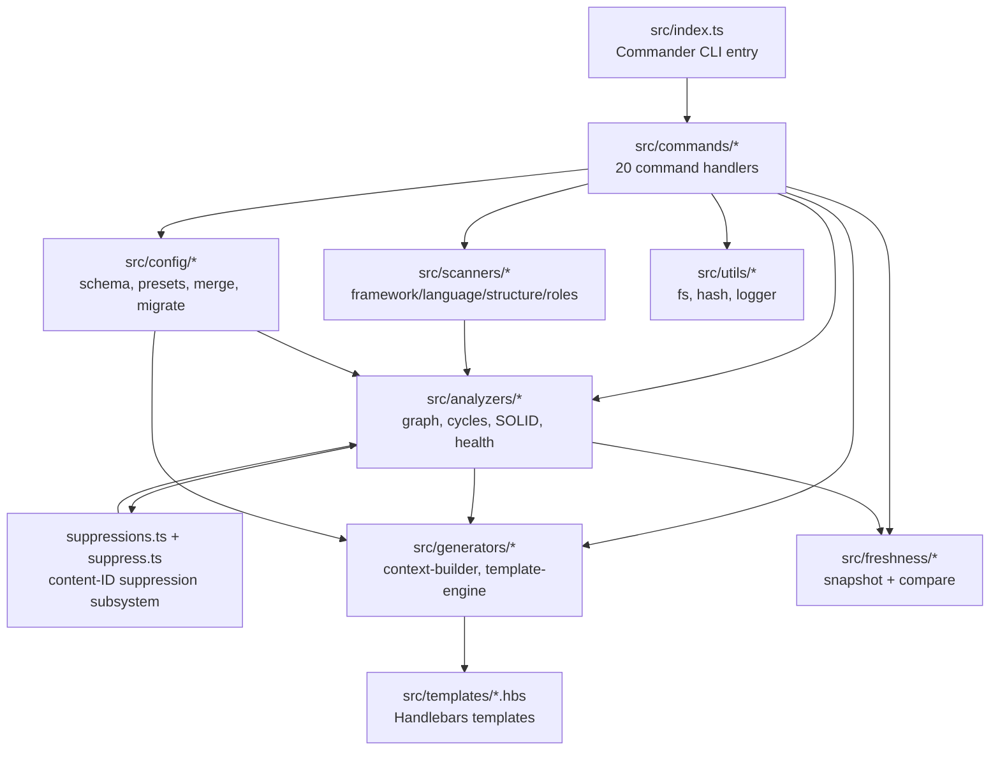
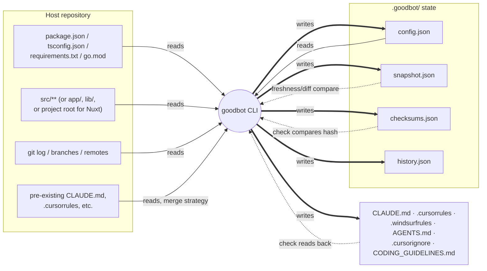
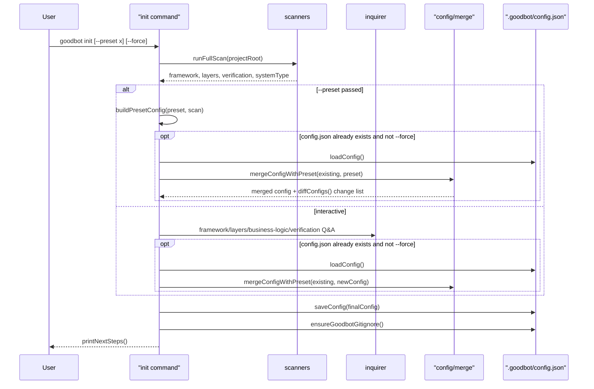
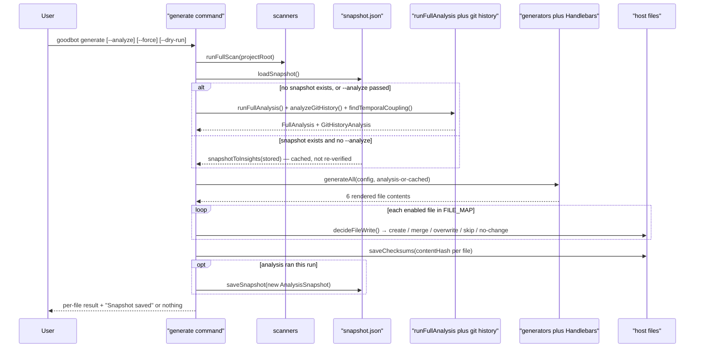
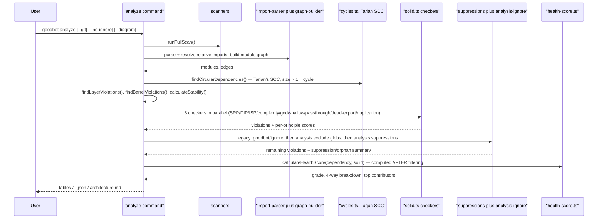
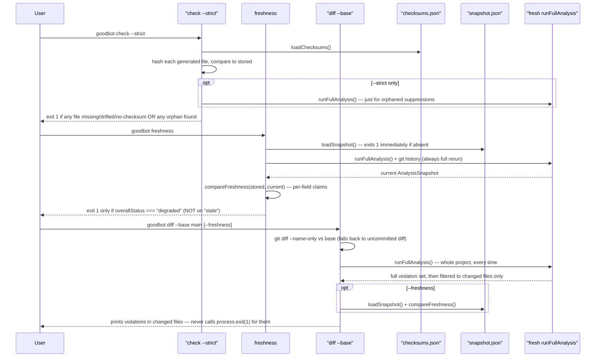

# goodbot — System Overview (verified against source)

This document describes what the goodbot codebase actually does, as read directly from `src/` and its test suite (`npm test` → 293 passing tests across 25 files, confirmed by running `npx vitest run`). `HOW_IT_WORKS.md` and `ARCHITECTURE.md` were read last and diffed against this model — see Section 7 for every place they disagree with the code. Where code and docs disagree, the code is treated as the truth.

All file paths below are relative to the repo root unless noted.

---

## 1. The one-screen summary

goodbot is a CLI (`bin/goodbot.js` → `src/index.ts`, built on Commander) that turns one canonical description of a project's architecture into the per-agent files that AI coding tools read (`CLAUDE.md`, `.cursorrules`, `.windsurfrules`, `AGENTS.md`, `.cursorignore`, `CODING_GUIDELINES.md`), and separately detects when the real codebase drifts from what those files claim. The canonical description lives in two places: `.goodbot/config.json` (team-authored: framework, layers, business-logic placement, custom rules, suppressions — written by `init`) and a point-in-time analysis snapshot, `.goodbot/snapshot.json` (machine-authored: health grade and violation counts at the moment of the last `generate --analyze`). The pipeline is always Scan (`src/scanners/`: framework/language/directory-layer/verification detection) → Analyze (`src/analyzers/`: import graph, cycles via Tarjan's SCC, layer/SOLID checks, suppression filtering, a weighted health score) → Generate (`src/generators/` + `src/templates/*.hbs`: Handlebars render into the six agent files, marker-aware so hand edits survive regeneration). Drift detection is three separate, narrower commands, not one mechanism: `check` only compares SHA-256 checksums of the generated files against what was last written (manual-edit detection); `freshness` re-runs the full analysis and compares it against the stored snapshot, field by field; `diff` re-runs the full analysis and filters the results down to files changed vs a base branch. The core loop the README's immune-system framing describes — canonical source → generated surfaces → drift detection → a human decides what to do about the drift — is real and implemented exactly as those three commands; the more ambitious "adjudication," "antibody," and "germline" vocabulary in `docs/EVOLUTION.md` is explicitly unbuilt roadmap, not a renamed version of something that already exists. Suppressions (`analysis.suppressions` in config) are the one place a human's "yes, I know, ignore this" decision is actually persisted, with a required reason and a content-derived ID (not a hash) that disappears if the violation is fixed and is flagged as "orphaned" if it no longer matches anything.

---

## 2. Component map



| Component | File path(s) | Responsibility | Depends on |
|---|---|---|---|
| CLI entry | `src/index.ts` | Registers 20 Commander subcommands, parses argv | `src/commands/*` |
| Command layer | `src/commands/*.ts` | One file per subcommand; composes scan/config/analyze/generate for that command's shape | scanners, config, analyzers, generators, freshness, utils |
| Scanners | `src/scanners/*.ts` | Detects framework (`framework.ts`, `framework-python.ts`), language (`language.ts`), directory layers + roles (`structure.ts`, `roles.ts`), verification commands (`verification.ts`), framework-specific conventions (`patterns.ts`), default branch (`index.ts`) | filesystem, `package.json`/manifests, git |
| Config/state | `src/config/*.ts` | Zod schema (`schema.ts`), legacy-key migration (`migrate.ts`), preset builders (`presets.ts`), per-framework defaults (`defaults.ts`), re-init merge policy (`merge.ts`), load/save of `config.json`/`checksums.json` (`index.ts`) | utils (JSON I/O) |
| Analysis engine | `src/analyzers/*.ts` | Import parsing (`import-parser.ts`), module resolution (`module-resolver.ts`), dependency graph (`graph-builder.ts`), stability metrics (`stability.ts`), cycle detection (`cycles.ts`, Tarjan's SCC), layer/barrel checks (`layer-checker.ts`, `barrel-checker.ts`), SOLID checkers (`srp-`, `dip-`, `isp-`, `complexity-`, `god-module-`, `shallow-module-`, `passthrough-`, `dead-export-`, `duplication-checker.ts`), custom rules (`custom-rules.ts`), legacy file ignores (`ignore.ts`), config-scoped excludes (`analysis-ignore.ts`), health scoring (`health-score.ts`), git history/temporal coupling (`git-history.ts`, `temporal-coupling.ts`) | scanners' structure output, config thresholds/excludes |
| Suppression subsystem | `src/analyzers/suppressions.ts`, `src/commands/suppress.ts` | Per-violation accept list keyed by content-derived IDs (file path or sorted cycle members, not a hash); orphan detection when a suppression matches nothing | analyzers' violation lists, config `analysis.suppressions` |
| Generators | `src/generators/context-builder.ts`, `template-engine.ts`, `mermaid.ts`, `index.ts` | Shapes scan+analysis+config data into one `GeneratorContext`; Handlebars setup/partials; `FILE_MAP` drives which of the 6 files get rendered; optional `architecture.md` Mermaid diagram | config, analyzers' `FullAnalysis`, templates |
| Templates | `src/templates/*.hbs`, `src/templates/partials/*.hbs` | Data-driven Handlebars templates (no `{{#if isNode}}` branching) for the 6 generated files | generator context only |
| Freshness/state | `src/freshness/snapshot.ts`, `compare.ts`, `types.ts` | Builds/serializes `AnalysisSnapshot`, rehydrates it for cached `generate` runs, computes per-field `fresh/stale/degraded/improved` claims | analyzers' `AnalysisInsights` |
| Utils | `src/utils/fs.ts`, `hash.ts`, `logger.ts`, `index.ts` | Swallow-on-error file I/O helpers, SHA-256 checksum (`contentHash`), console logging | — |

Everything named above exists as described — there is no component the docs invoke that is missing from `src/`.

---

## 3. The host-attachment view



Arrow legend: solid (`-->`) = goodbot reads this from the host; thick (`==>`) = goodbot writes this into the host; dotted (`-.->`) = read back later for verification.

**Reads from host:** `package.json` deps+scripts (`src/scanners/framework.ts`, `verification.ts`), `tsconfig.json` existence (`src/scanners/language.ts`), `requirements.txt`/`pyproject.toml`/`setup.py`/`go.mod` (`framework.ts`, `framework-python.ts`), every `.ts`/`.tsx`/`.js`/`.jsx` file under the detected src root (`src/analyzers/module-resolver.ts` `SOURCE_EXTENSIONS`), `git log --numstat` for history/hotspots (`src/analyzers/git-history.ts`), `git symbolic-ref`/`ls-remote`/`rev-list` for default branch (`src/scanners/index.ts` `detectDefaultBranch`), and any pre-existing agent files to decide merge vs overwrite vs skip (`src/commands/file-write-decision.ts`).

**Writes into host:** the 6 files in `src/generators/index.ts` `FILE_MAP` (`CODING_GUIDELINES.md`, `CLAUDE.md`, `.cursorrules`, `.windsurfrules`, `AGENTS.md`, `.cursorignore`), plus `.goodbot/config.json`, `.goodbot/snapshot.json`, `.goodbot/checksums.json` (all via `src/config/index.ts`), `.goodbot/history.json` (via `src/commands/trend.ts`, only on `trend --record`), and `.goodbot/.gitignore` (auto-created by both `init` and `generate`, see `src/commands/init.ts` `ensureGoodbotGitignore`). `init`/`generate` write that gitignore with exactly `snapshot.json`, `checksums.json`, `history.json` listed — `config.json` is implicitly left committed.

**Reads back for verification:** `check` re-reads `checksums.json` and the 6 generated files and compares SHA-256 hashes only (`src/commands/check.ts`) — it does **not** re-run analysis unless `--strict`, and even then only to check suppression orphans, not file content. `freshness` requires `snapshot.json` to already exist, re-runs the full analysis + git history, and diffs every field against the stored snapshot (`src/freshness/compare.ts`). `diff` always re-runs the full analysis on the whole project (not just changed files) and then filters the violation lists down to files that changed vs the base branch (`src/commands/diff.ts` `filterToChangedFiles`); it only touches `snapshot.json` if you pass `--freshness`.

### State inventory

| File | Produced by | Consumed by | Committed? | If deleted |
|---|---|---|---|---|
| `.goodbot/config.json` | `init`, `suppress --apply`, `sync` | nearly every command (`loadConfig`) | **Yes** | Most commands fall back to scan-only behavior or print `"No .goodbot/config.json found. Run goodbot init first."` and `process.exit(1)` (e.g. `generate`, `check`) — corrupted (unparseable) JSON produces the *same* "not found" message, since `safeReadJson` swallows parse errors (`src/utils/fs.ts`) |
| `.goodbot/snapshot.json` | `generate --analyze` (or first-ever `generate`) | `freshness`, `diff --freshness`, `check` (age-only), `ci`, cached `generate` reruns via `snapshotToInsights` | **No** (gitignored) | `freshness` hard-exits with an error (`loadSnapshot` returns null → `process.exit(1)`); `generate` silently falls back to treating the run as "first run" and re-analyzes; `check` just skips the age warning |
| `.goodbot/checksums.json` | `generate` (every run, even `--dry-run` skips writing but not the rest) | `check` | **No** (gitignored) | `check` immediately errors: `"No checksums found. Run goodbot generate first."` |
| `.goodbot/history.json` | `trend --record` only | `trend` (render/`--effectiveness`) | **No** (gitignored) | `trend` without `--record` prints `"No history yet."`; no other command touches it |
| `.goodbot/.gitignore` | `init`, `generate` (only if missing) | nothing reads it programmatically | **Yes** | Nothing breaks; it just won't be regenerated to reflect new state filenames, and the 3 state files above could get accidentally committed |
| `.goodbot/ignore` (legacy, plain text) | hand-written by the user only — no command writes it | `runFullAnalysis` via `src/analyzers/ignore.ts` | Not addressed by any doc or `.gitignore` entry | If deleted, those violations simply reappear in the next analysis — no error |
| `CLAUDE.md`, `.cursorrules`, `.windsurfrules`, `AGENTS.md` | `generate` | `check` (hash compare); humans/agents | **Yes** (intended to be) | `check` reports them `✗ missing`; `generate` treats absence as "create" |
| `.cursorignore`, `CODING_GUIDELINES.md` | `generate` (never merged — `mergeWithExisting: false` in `FILE_MAP`) | `check`; Cursor itself; other agent files point to `CODING_GUIDELINES.md` as source of truth | **Yes** | Same as above; these two are always fully overwritten, never marker-merged |

---

## 4. Command lifecycles

### `init`



Surprising details: the merge is a **fixed field-level policy**, not a negotiated decision — `mergeConfigWithPreset` (`src/config/merge.ts`) hardcodes exactly which top-level fields get refreshed from the scan (`project.framework`, `project.language`, `architecture.systemType`, per-layer `level`/`hasBarrel` are *kept from the existing* config while layer *membership* comes from the fresh scan) versus preserved outright (`businessLogic.*`, `verification.typecheck/lint/test`, `agentFiles.*`, `conventions.*`, `analysis.*`, `customRulesConfig`, `team`, `output`). There is no per-field confirmation step — the config is saved immediately after the merge; the printed "N detected-fields refreshed" list is informational, after the fact. `--force` is the only way to bypass the merge and fully reset, and it skips the merge function entirely rather than "choosing" differently within it.

### `generate`



Surprising details: a plain `goodbot generate` on a project that already has a snapshot does **no analysis at all** — it reuses whatever health grade and violation counts were cached in `snapshot.json`, however old, and the CLAUDE.md "Current Health" block it writes can be stale for weeks with no warning (`src/commands/generate.ts` lines ~42-53). The snapshot is only refreshed when `--analyze` is passed or the snapshot doesn't exist yet. `--dry-run` goes through the exact same `decideFileWrite` logic but skips `saveChecksums`/`saveSnapshot` entirely, so a dry run genuinely changes nothing on disk.

### `analyze`



Surprising details: cycle detection genuinely is Tarjan's strongly-connected-components algorithm as the docs claim (`src/analyzers/cycles.ts`) — any SCC with >1 node is reported as a cycle. The health score is computed **after** every suppression/exclude filter runs, so suppressed violations never cost points but still print as "(N suppressed)" in the CLI. Import resolution only follows specifiers starting with `.` or `/` (`src/analyzers/import-parser.ts` `isRelative`) — path aliases (e.g. `@/lib/...`) are invisible to the entire dependency graph, cycle detection, layer checks, and barrel checks; nothing in the codebase resolves `tsconfig.json` `paths`. The exact health-grade formula is in Section 5.

### `check --strict`, `freshness`, `diff`



Surprising details: `check`'s core comparison is **checksum-only** — it never re-reads file *content* for meaning, just a SHA-256 match against what `generate` last wrote (`src/commands/check.ts`). `freshness`'s exit code is 1 only on `degraded`, not on `stale` — a project that's merely out of date (not worse) exits 0, so wiring `freshness` into a hard CI gate without reading its output can miss real staleness. `diff` is not actually incremental: it re-runs the *entire* project's analysis every time and filters the result set down to changed files (`filterToChangedFiles`) — for a large repo this costs the same as `analyze`. Most strikingly, `diff` never calls `process.exit(1)` for violations found in changed files (only for a thrown error) — unlike `score` (exits 1 on D/F) and `check` (exits 1 on drift) — so a CI step that runs `goodbot diff` and trusts its exit code alone will always pass, violations or not; `goodbot ci` or `goodbot check` would need to be the actual gate.

---

## 5. The data model

### `config.json`

```jsonc
{
  "version": 1,
  "project": { "name", "framework", "language", "description?" },      // read by: generate/context-builder, init merge, onboard
  "architecture": { "layers[]", "dependencyDirection", "barrelImportRule", "interfaceContracts", "systemType" }, // read by: analyze (barrel/layer checks), generate
  "businessLogic": { "allowedIn[]", "forbiddenIn[]", "redFlags[]" },    // read by: generate/context-builder, onboard
  "verification": { "typecheck", "lint", "test", "format", "build" },  // read by: generate, onboard (NOT read by hooks — hooks.ts never loads config)
  "agentFiles": { "claudeMd"..."codingGuidelines", "existingFileStrategy" }, // read by: generate, check (which files to compare)
  "conventions": { "mainBranch", "importStyle", "customRules[]" },     // read by: generate, freshness (customRules list is a tracked claim)
  "analysis": { "solid", "thresholds", "budget", "exclude", "suppressions[]" }, // read by: runFullAnalysis (thresholds/exclude/suppressions), checkBudget() in analyze/ci/score
  "customRulesConfig": [ /* CustomRule[] */ ],                          // read by: checkCustomRules() inside runFullAnalysis
  "team": { "syncUrl?", "name?" },                                      // read by: sync.ts only
  "output": { "cursorignore": { "paths[]", "sensitiveFiles[]" } }       // read by: generate/context-builder (cursorignore.hbs), does NOT affect analysis
}
```

### `snapshot.json` (`AnalysisSnapshot`, `src/freshness/types.ts`)

```jsonc
{
  "generatedAt": "ISO-8601",
  "healthGrade": "B+", "healthScore": 80,
  "circularDeps": 0, "barrelViolations": 3, "layerViolations": 0,
  "srpViolations": 4, "complexityViolations": 1, "duplicationClusters": 0, "deadExportCount": 2,
  "shallowModules": ["..."], "godModules": ["..."],
  "oversizedFiles": ["..."], "highComplexityFiles": ["..."],
  "deadExportModules": [{ "module": "...", "exports": ["..."] }],
  "hotspotFiles": ["..."], "aiCommitRatio": 0.42,
  "temporalCouplings": [{ "fileA", "fileB", "strength" }],
  "customRules": ["..."], "moduleCount": 12, "filesParsed": 340
}
```

Every one of these fields is independently compared in `src/freshness/compare.ts`: counts use "any change is meaningful" (`compareViolation`); `healthScore`/`aiCommitRatio` use a tolerance threshold (5 points / 5pp) before flagging; file-name lists (`hotspotFiles`, `oversizedFiles`, `godModules`, `shallowModules`) are flagged `stale` on *any* change, not just >30% (the `>0.3` branch and the fallback "minor changes" branch produce identical output in `compareList` — see Section 7).

### Suppression IDs (content-derived, not a hash)

Implemented in `src/commands/suppress.ts`. Two shapes:
- **File-based** (layer/barrel/SRP/DIP/ISP/etc violations): `` `${rulePrefix}-${slugify(file)}` ``, e.g. `layer-src-scripts-migrate`. `slugify` strips the extension, replaces non-alphanumerics with `-`, lowercases.
- **Cycle-based**: dedupe the cycle's module names, sort alphabetically, slugify each, join with `-`, prefix `cycle-`, e.g. `cycle-app-database`. Direction and Tarjan's trailing-repeat convention (`[a,b,c,a]`) are normalized away by the sort+dedupe.

This is deliberately **not** a cryptographic hash — it's a readable deterministic slug so IDs are guessable from the violation itself. Collisions (two different violations producing the same slug) are handled only within a single `suppress` invocation: `collectCandidates` tracks a `seenIds` set and appends `-2`, `-3`, etc. There is no persistent collision registry — if a real collision occurs, the disambiguating suffix is not guaranteed stable across separate runs if the violation set changes order. This is a different algorithm from `contentHash()` (`src/utils/hash.ts`), which **is** a real hash (SHA-256, truncated to 16 hex chars) — but that one is used only for `checksums.json`, to detect whether a generated file's exact bytes changed.

### Health grade formula (`src/analyzers/health-score.ts`)

```
dependencies = 100 − (circularDeps×25 + layerViolations×8 + barrelViolations×3), floored at 0
stability    = 100 − (stabilityViolations×15), floored at 0
solid        = solid.scores.overall   // avg of SRP/DIP/ISP sub-scores, see below
architecture = 15 (modules>0) + 15 (modules≥4) + 10 (modules≥8)
             + {30 if avgCoupling≤2, 20 if ≤3, 10 if ≤5, else 0}
             + 15 (barrelViolations==0)
             + {15 if maxFanOut≤3 && maxFanIn≤3, 10 if ≤5 && ≤5, else 0}
             − layerViolations×15                 // can go negative before the final floor
             capped to [0,100]

score = round(dependencies×0.30 + stability×0.20 + solid×0.25 + architecture×0.25)

grade: ≥95 A+ · ≥85 A · ≥78 B+ · ≥70 B · ≥63 C+ · ≥55 C · ≥40 D · else F
```

`solid.scores.overall` is the average of three sub-scores, each computed the same way in `src/analyzers/solid.ts`: `penalty = (errors×10 + warnings×5 + infos×1) / max(sqrt(totalFiles/10), 1)`, `score = max(0, round(100 − penalty))`. All checkers except complexity/dead-export/god/shallow/duplication map to the `SRP` principle bucket for scoring purposes — `DIP` and `ISP` each only have one real contributing checker. With `totalFiles === 0` (e.g., an unparseable project, see Section 7) every sub-score defaults to 100 and `architecture` defaults to 0, which — unweighted-looking as it seems — still produces a specific, non-obvious number; see Section 7's "fake grade" finding.

---

## 6. Immune-vocabulary ↔ code mapping

Both `HOW_IT_WORKS.md` and `ARCHITECTURE.md` carry this identical table mapping shipped features to immune terms; `README.md` and `docs/EVOLUTION.md` add the forward-looking terms. Below, each term is checked against the actual implementation.

| Term | Docs' claim | Real code | Verdict |
|---|---|---|---|
| **Genome** | "`CODING_GUIDELINES.md` → generated agent files" expresses the genome into enforcement surfaces | `src/generators/index.ts` `FILE_MAP` + `generateAll()`; `src/templates/CODING_GUIDELINES.md.hbs` as the one template all others point back to in their own text | Accurate — one real source, fanned out mechanically |
| **Innate sensor** | Drift detection (`check`/`freshness`/`diff`, per HOW_IT_WORKS; `diff`/`pr` per ARCHITECTURE) | `src/commands/check.ts` (checksum compare), `src/freshness/compare.ts` (snapshot compare), `src/commands/diff.ts` (filtered re-analysis) | Real and working, but `pr.ts` (included in ARCHITECTURE's version of this row) does no stored-baseline comparison at all — see Section 7 |
| **Proto-ratchet** | Suppression lifecycle: "tolerated exceptions, tracked, meant to shrink" | `src/analyzers/suppressions.ts` (filtering), `src/commands/suppress.ts` (`validateReason` rejects empty/TODO/short reasons; orphan detection in `runFullAnalysis`) | The *tracking* is real. "Meant to shrink" is pure framing — nothing in the code nudges, expires, or counts down suppressions. `trend --effectiveness` tracks violation-category trends but is never joined to the suppression list. There is no mechanism that makes suppressions shrink; a suppression persists forever until a human manually runs `unsuppress` |
| **Proto-adjudication** | Re-init preservation of user customizations: "distinguishing mine from yours" | `src/config/merge.ts` `mergeConfigWithPreset()` | This is a hardcoded, static field-level merge policy (listed exhaustively in Section 4's `init` notes) — not an adjudication process. No choice is presented per field; the merge happens and is reported after the save. The word "distinguishing" overstates a lookup table |
| **Tolerance** (EVOLUTION.md intro) | The immune system tolerating harm that gets in without dying of its own defenses | Same suppression mechanism as proto-ratchet above | Same gap — tracked tolerance exists, no self-limiting mechanism |
| **Memory** (EVOLUTION.md intro) | Remembering past encounters so the next one is cheaper | No code. Suppression `reason` is free text, not linked to any incident ID or searchable history | Not implemented, and EVOLUTION.md says so explicitly |
| **Adjudication loop** (EVOLUTION.md Phase 1) | Every drift finding gets a recorded reject/accept-as-evolution verdict | No code — `freshness`/`diff` print a report; nothing records a decision anywhere | Confirmed not built, matches doc's own "Status: roadmap" framing |
| **Antibody** (EVOLUTION.md Phase 2) | Escaped incidents become proposed permanent rules with provenance | No code | Confirmed not built |
| **Self-tuning** (EVOLUTION.md Phase 3) | Per-rule false-positive tracking → proposed demotions/threshold changes | `src/commands/trend.ts` `renderEffectiveness()` — compares first-half vs second-half averages per violation category and prints "improving"/"worsening"/"stable" | The doc calls this "an embryo" and is accurate: it's a trend readout only, with no proposal mechanism, no demotion logic, no threshold feedback |
| **Germline** (EVOLUTION.md Phase 4) | Rule packs proven on one host become versioned defaults for new hosts | No code — `presets.ts` ships 3 static presets (`strict`/`recommended`/`relaxed`), not anything derived from a host's proven history | Confirmed not built |

Overall: the honesty-audit framing in `README.md` ("Where the metaphor and the actual engineering disagree, the engineering wins") holds up — the docs do not overclaim the roadmap items as shipped. The one soft spot is the *shipped* vocabulary itself: "proto-ratchet" and "proto-adjudication" describe static, one-shot mechanisms (a reason-required list; a field-merge policy) with language ("meant to shrink," "distinguishing mine from yours") that implies more adaptivity than either actually has.

---

## 7. Findings

### Docs-vs-code mismatches

1. **`ARCHITECTURE.md` command table, `suppress`/`unsuppress` row**: claims both run "Scan + Analyze (no-ignore) + config write." `suppressCommand` does (`src/commands/suppress.ts`, calls `runFullScan` + `runFullAnalysis(..., { noIgnore: true })`), but `unsuppressCommand` in the same file never scans or analyzes anything — it only calls `loadConfig`, matches the given ID against each existing suppression's recomputed ID via `suppressionMatchesId()`, and calls `saveConfig`. No violation data is touched.
2. **`ARCHITECTURE.md`'s immune-framing table, "Innate sensor" row**: lists `diff` / `pr` as the drift-detection surfaces. `src/commands/pr.ts` runs a fresh `runFullAnalysis` and lists violations in changed files, but never loads or compares against `snapshot.json` — it has no concept of a stored baseline, so it isn't a "sensor" for drift in the same sense `check`/`freshness`/`diff --freshness` are. `HOW_IT_WORKS.md`'s version of the identical table correctly lists `check`, `freshness`, `diff` instead — the two docs disagree with each other, and `ARCHITECTURE.md`'s version is the inaccurate one.
3. **`HOW_IT_WORKS.md`, "Your imports" section**: says "Every `.ts` / `.tsx` / `.js` file in `src/` gets parsed," omitting `.jsx` from the prose list even though `SOURCE_EXTENSIONS` in `src/analyzers/module-resolver.ts` includes it. Minor, but the written list and the code list aren't identical.

### Surprises

- **Two different "default" file-size thresholds exist and nothing reconciles them.** `src/analyzers/types.ts` `DEFAULT_THRESHOLDS` (used when a project has no `config.json`, e.g. `goodbot scan --analyze` with no config) sets `maxFileLines: 200`. But both `src/commands/init.ts` and `src/config/presets.ts` hardcode `maxFileLines: 300` whenever they write a fresh config. So the *same* project gets evaluated against a 200-line threshold before `init` and a 300-line threshold after — a silent behavior change the moment a user runs `init`, with no doc mentioning it.
- **Three independent, overlapping suppression/ignore mechanisms exist simultaneously**: the legacy plain-text `.goodbot/ignore` file (`src/analyzers/ignore.ts`, whole-file/whole-principle, no JSON schema, not even gitignored by default), `analysis.exclude` in `config.json` (glob-based, category-wide, applied before suppressions), and `analysis.suppressions` (per-violation, ID-based, the only one with a required reason and orphan detection). `runFullAnalysis` applies all three in sequence every run. Nothing in the docs explains why there are three or when to use which.
- **A project with zero analyzable source files still gets a real-looking grade.** When `sourceFiles.length === 0` (e.g., a pure-Python or pure-Go repo — see Fragility below), `runFullAnalysis` short-circuits to an "empty" dependency analysis and a SOLID analysis where every sub-score defaults to 100 (`calculateScores` early-returns `{srp:100, dip:100, isp:100, overall:100}` when `totalFiles===0`). Plugging that into `calculateHealthScore`: `dependencies=100, stability=100, solid=100, architecture=0` (no modules ⇒ no architecture points) → `score = 100×0.30 + 100×0.20 + 100×0.25 + 0×0.25 = 75` → **grade B**. A completely unanalyzed codebase reports "B (75/100)" indistinguishably from a real, moderately healthy one.
- **A corrupted `config.json` is silently treated as "no config at all."** `safeReadJson` (`src/utils/fs.ts`) catches `JSON.parse` errors and returns `null` just like a missing file would; `loadConfig` then throws the generic "No .goodbot/config.json found. Run `goodbot init` first." — which is actively misleading if the real problem is a syntax error in an existing file.
- **`freshness --watch` and the SIGINT handler in `watch.ts`/`freshness.ts`** both install `process.on('SIGINT', ...)` and then `await new Promise(() => {})` to keep the process alive — functionally fine, but it means neither command can be driven programmatically with a timeout; both are interactive-terminal-only despite having a `--json` flag that implies scriptability.
- **`hooks.ts` never reads `config.json` at all** — the installed git hooks are static shell snippets that always call `goodbot check`/`goodbot freshness` with no configuration of which checks or thresholds apply, regardless of anything in `analysis.budget` or `agentFiles`.
- **`fix.ts`'s SRP "fix" only inserts comments** — `fixSRPViolations` adds `// --- goodbot: consider extracting to X ---` markers; it is advisory text, not a refactor, despite sitting alongside genuinely mechanical fixes (barrel import rewriting, dead-export removal, barrel sorting) in the same command.
- **`sync.ts`'s `--push` destination can be any local path, not just a shared git location** — `pushConfig` just writes `config.json`'s JSON to whatever path is given; nothing validates it's inside a repo or reachable by teammates, despite the command's framing as "team config sync."

### Fragility notes (for testing against an unfamiliar repo)

1. **Monorepos are not handled.** `analyzeStructure` (`src/scanners/structure.ts`) only looks for `src`, `app`, or `lib` directly under the project root (with one-off cases for Angular's `src/app` and Nuxt's root-level convention). A typical monorepo (`packages/*/src`, `apps/*/src`) has none of these at the root, so `srcRoot` comes back `null` and the entire dependency/SOLID pipeline silently returns an empty analysis — no error, just a misleadingly clean (or, per the "fake grade" finding above, a flat B) report. `detectFramework` also only reads the *root* `package.json`, which in a monorepo frequently has none of the actual framework dependencies (those live in each workspace package).
2. **Path aliases are invisible.** `isRelative()` in `src/analyzers/import-parser.ts` only treats specifiers starting with `.` or `/` as resolvable; anything like `@/components/...` or a `tsconfig.json` `paths` mapping (extremely common in Next.js projects — one of goodbot's named supported frameworks) is silently dropped from the import graph. Cycles, layer violations, and barrel violations through aliased imports will never be detected.
3. **Non-TypeScript/JavaScript codebases get framework detection but no analysis.** `detectFramework`/`detectPythonFramework` correctly identify Django/Flask/FastAPI/Go, and `detectSystemType` classifies them as `api`. But `collectSourceFiles` (`src/analyzers/module-resolver.ts`) only walks `.ts`/`.tsx`/`.js`/`.jsx` — a pure-Python or pure-Go repo will always produce `sourceFiles.length === 0`, triggering the "fake B grade" behavior described above. The entire SOLID/dependency-graph engine is TS/JS-only despite the framework/language scanners implying broader support.
4. **Framework-specific "conventions" coverage is uneven.** `detectFrameworkPatterns` (`src/scanners/patterns.ts`) only has real detectors for `nest`, `react`, `react-native`, `next`, and `express` — Vue, Angular, Nuxt, Django, Flask, FastAPI, Go, and plain Node all fall through to `{ conventions: [], structuralNotes: [] }` even though `roles.ts` gives several of them (Vue, Angular, Nuxt) rich, framework-specific *layer* role sets. The two subsystems' framework coverage don't match.
5. **Everything is line-based regex/heuristic, not an AST**, so anything syntactically unusual will silently mis-parse rather than error: multi-line imports are only detected via a specific "line has `{` but not `}` or `from`" heuristic (`import-parser.ts` `parseFileImports`), the complexity checker counts keywords as plain-text matches with no awareness of string/template-literal contents beyond simple comment-stripping, and the duplication checker's line-normalization (`duplication-checker.ts` `normalizeLine`) only strips quoted strings and numeric literals — unusual formatting (e.g. heavy use of template literals, JSX-heavy files, or decorators spanning multiple lines) can produce false negatives or false positives in all of these without any error being raised. On a codebase in an unfamiliar style, the safest assumption is that the numbers are approximate, not a parse-verified ground truth.

---

*Generated by reading `src/`, the `vitest` suite (293 tests / 25 files, verified by running them), then `HOW_IT_WORKS.md`, `ARCHITECTURE.md`, `README.md`, and `docs/EVOLUTION.md` last, per the review's methodology.*
